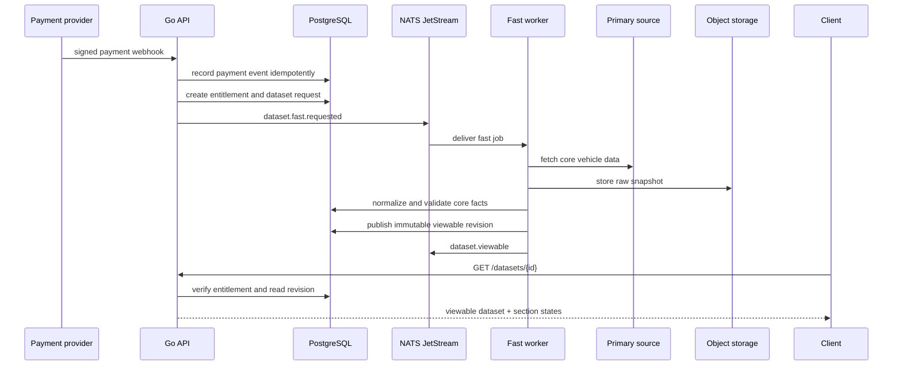
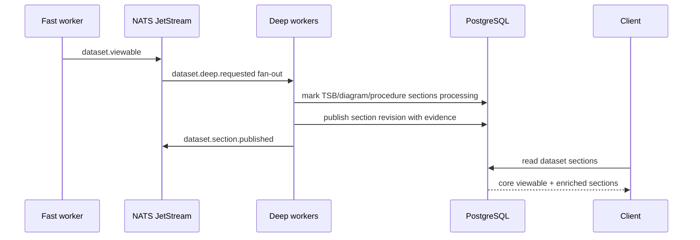
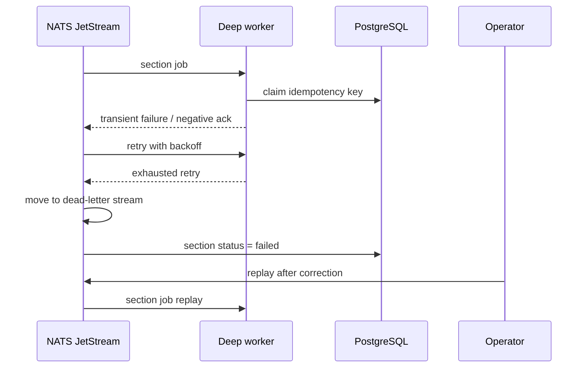
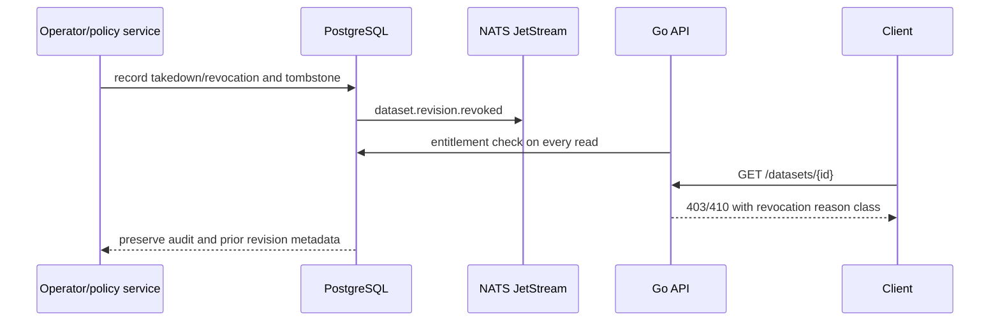
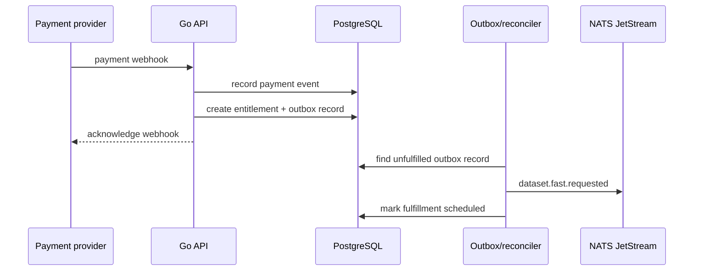

# AutoData Dataset Lifecycle

## Lifecycle contract

The purchaser-facing unit is a vehicle-specific dataset projection selected by make, model, year, and region. A one-time purchase creates an entitlement to that projection and its permitted future enrichment revisions. The first usable revision is produced by the fast lane; the deep lane enriches it without blocking access.

```text
Payment success
  -> entitlement created
  -> dataset request created
  -> fast-lane job scheduled
  -> primary source fetched
  -> vehicle identity/core facts normalized
  -> minimum viewable contract validated
  -> projection revision published
  -> user can view dataset
  -> deep-lane jobs fan out
  -> TSBs, images, diagrams, wiring, procedures,
     evidence, embeddings, and quality checks publish incrementally
```

## Overall states

| State | Meaning | Allowed next states |
| --- | --- | --- |
| `purchased` | Payment is confirmed and an entitlement exists; work has not begun | `fast_lane_processing`, `failed`, `revoked` |
| `fast_lane_processing` | The minimum viewable dataset is being fetched, normalized, and validated | `viewable`, `failed`, `needs_review`, `revoked` |
| `viewable` | The minimum contract is published and readable by the entitled purchaser | `enriching`, `complete`, `revoked` |
| `enriching` | One or more deep sections are being processed | `complete`, `viewable`, `needs_review`, `revoked` |
| `complete` | All product-declared sections have a successful published revision | `revoked` |
| `failed` | A required lane failed and needs retry or operator action | `fast_lane_processing`, `needs_review`, `revoked` |
| `needs_review` | Validation, confidence, source drift, or policy requires human action | `fast_lane_processing`, `enriching`, `viewable`, `revoked` |
| `revoked` | Access or publication was withdrawn for refund, takedown, policy, or administrative reason | none |

`viewable` is monotonic with respect to access: once an entitled user has a valid viewable revision, a deep-lane failure does not take the dataset back to an unavailable state. Revocation is an explicit policy transition, not a processing failure.

## Section states

Every product section has its own state: `pending`, `processing`, `viewable`, `complete`, `failed`, or `needs_review`. A dataset may be `viewable` while diagnostics, TSBs, diagrams, and embeddings remain `processing`. The API returns these states so a client can render partial availability accurately.

The product definition declares the minimum viewable set. The default reference set is vehicle identity, source metadata, core specifications, and the product's explicitly required base sections. Deep material such as TSBs, image/diagram extraction, wiring topology, procedures, evidence indexing, and semantic embeddings is not required for first view unless a product explicitly includes it in its minimum contract.

## Fast lane

1. Accept a payment confirmation only after webhook signature verification and idempotent event recording.
2. Create or reuse the entitlement using the payment event's stable provider ID.
3. Create or reuse a dataset request for the vehicle selector and product.
4. Fetch the primary source using a source adapter with a checkpoint and source watermark.
5. Store the raw source snapshot and content hash in object storage and PostgreSQL.
6. Normalize identity, applicability, source metadata, and core facts.
7. Validate required fields, source identity, units, referential relationships, and minimum confidence.
8. Publish an immutable viewable projection revision.
9. Emit `dataset.viewable` and schedule deep-lane work.

Fast-lane work is successful only when the minimum viewable contract is valid. A source timeout, schema mismatch, missing vehicle match, or unresolvable ambiguity results in `failed` or `needs_review`, never a false `viewable` state.

## Deep lane

After viewable publication, the request fans out to independent enrichment jobs for:

- TSB and diagnostic extraction.
- PDF/image OCR and page-level evidence.
- Repair procedures, safety warnings, torque/spec references, and media.
- Wiring diagrams, harnesses, connectors, pins, splices, grounds, and network topology.
- Parts, tools, software flashes, and maintenance schedules.
- Embeddings and retrieval indexes.
- Cross-record validation and human-review queues.

Each section can publish independently. A successful section publication creates a new immutable revision or an explicitly linked section revision, updates section status, records its source watermark and changelog, and emits `dataset.section.published`. A failed section is retried with bounded backoff, then sent to a dead-letter stream and marked `failed`; the last successful section revision remains readable.

## Idempotency and checkpoints

The stable processing key is:

```text
source_snapshot_id + dataset_request_id + lane + processing_version
```

Handlers must use an inbox or equivalent deduplication record before applying side effects. Source adapters checkpoint pagination/page ranges. Document workers checkpoint per document/page. Publication uses a compare-and-publish operation so a duplicate event cannot create two revisions for the same input key.

## Sequence diagrams

### Successful purchase and fast-lane publication



### Fast publication followed by deep enrichment



### Deep retry and dead-letter handling



### Takedown or entitlement revocation



### Payment success with delayed fulfillment



## Workshop retryable reader amendment — reviewed development fix, 2026-11-04

Current result: the reader fix is implemented at `4076ad3a197a6e520269f3dabd2a14f9b2e3d50f` ([draft PR #206](https://github.com/lucronn/autodata/pull/206)) after the synchronized gate `4f007d040da9834ead006d48aa2d641b3df412a7` passed full-SHA preflight. Focused Node tests passed 8/8; full Workshop Node tests passed 59/59; both syntax and exact two-file diff checks passed. Independent exact-code review PASS was relayed by the coordinator from `/root/reader_code_review`; the reviewer reproduced the parent defect, reran the checks and found no actionable issues. No saved review receipt/hash exists.

Completion tracking: [Issue #186 completion comment](https://github.com/lucronn/autodata/issues/186#issuecomment-6633937350), Project #8 still In Progress. Record/task/queue `completion` fields retain fresh complete Issue/all 135 comments/current Project evidence, exact hashes and todo disposition. Items 1–4 and implementation verification/review are complete; independent docs checkpoint review remains pending.

Synthetic Node reader fix at the e5fed171bb36fdb759c592cbcd0e15aea5490c97 lineage only. Final integrated candidate acceptance for 180 distinct cases (identity 5, catalog 8, commerce 14, paid 12, DTO 120, API 21), support/CI/security/image/SDK/license checks, and real staging Firebase/Stripe TEST/both-bank/model/recovery/cars.tk remain unverified and separately gated. No merge, deployment or production-readiness claim.

The original synchronized planning text below is retained as history; its proposed/pending status describes the gate before dispatch. The current result above supersedes that status only for this bounded development fix.

**Goal:** Keep readable Workshop source visible and continue bounded sequential article GET polling through retryable job failures until canonical publication or a terminal outcome, without scheduling another rewrite.

This reader-only amendment is based on `e5fed171bb36fdb759c592cbcd0e15aea5490c97`. Its exact goal, two-file scope, five todos and references are **synchronized** in [Issue #186 detail comment](https://github.com/lucronn/autodata/issues/186#issuecomment-6624605837) and [Project #8](https://github.com/users/lucronn/projects/8) item `PVTI_lAHOCSJ8cc4BiQ2BzhFocs4`, read back at `2026-11-04T14:54:42Z`. Implementation still requires a committed pinned checkpoint, passing full-SHA machine preflight and independent coordinator gate handoff. This describes proposed behavior; it reports no implemented fix and authorizes no dispatch, merge or deployment.

For an opened article with a durable job ID, `processing.state=failed` and `processing.retryable=true` means the browser should retain readable source and continue sequential GET observation, honoring the existing retry-after/backoff and 120-second maximum absolute budget. `failed` without exactly `retryable=true`, `completed`, `needs_review` and `withdrawn` remain terminal. Navigation cancellation must prevent subsequent requests and updates. The browser must not call prepare again or dispatch another canonical rewrite to recover; backend transformation ownership, source/media rights and warm publication reuse remain authoritative.

Implementation is restricted to `apps/api-go/workshop/article-read.mjs` and `apps/api-go/workshop-client.test.mjs`. Pending/failed article-index hydration, purchase labels, payment/entitlement, backend retry/scheduling, media handling, bundles, fixtures, acceptance inventories and release authority require separate scopes. Existing 55 passing Node tests and the deterministic early-exit reproduction establish helper behavior only; they prove no production Firebase, Stripe, connector or model outcome.

Plan: [docs/superpowers/plans/2026-11-04-workshop-retryable-reader.md](../superpowers/plans/2026-11-04-workshop-retryable-reader.md). Task: `docs/agents/tasks/2026-11-03-production-release/workshop-retryable-reader.json`. Record: `docs/agents/records/2026-11-04-workshop-retryable-reader.json`. Queue: `docs/agents/tasks/2026-11-03-production-release/queue.json`. The new queue entry awaits gate handoff and both records are synchronized; implementation_authorized remains false. Exact comment/Project hashes, prior Project Source text, and full Issue body/all 134 comments are retained by the tracking_sync record and its hashed `/home/corp/.codex/worktrees/workshop-retryable-reader-plan/reader-gate-live-tracking.json` readback archive. Prior queue entries and live Issue body/comments are preserved. The original before-item snapshot was lost; unrelated Project-field preservation is the coordinator-confirmed original assertion, while the fresh archive proves the complete current state. Prior Source text/hash remain verbatim in tracking_sync; no full before-item snapshot was reconstructed.

Concrete todo, identical to the synchronized Issue/Project and gate record:

1. Synchronize this reader-only goal, exact two-file scope, five todos, plan/task/record/queue and dataset lifecycle document in existing Issue #186 and Project #8; read back live tracking, commit and push the planning checkpoint, pin its full SHA and pass machine preflight before implementation.
2. Add a failing deterministic Node regression for readable source with failed/retryable=true and retry_after_seconds transitioning through queued and rewriting to completed canonical; assert source updates, sequential GET reads, honored delay and one terminal canonical update.
3. Change processingArticle only so failed is active exactly when retryable===true and job_id exists; preserve completed, needs_review, withdrawn and nonretryable failure as terminal, with no additional prepare POST or rewrite scheduling.
4. Add deterministic boundary tests for failed with false or missing retryable, persistent retryable failure reaching the existing absolute budget with source retained, and navigation abort during backoff preventing a later read or update.
5. Run focused red/green tests, the full Workshop Node suite, syntax and diff/scope checks; commit and promptly push the coherent validated fix to the coordinator-assigned branch, obtain independent exact-commit review and record evidence without merge, deployment or live-payment authority.


## Synchronized final reviewed Workshop leaf integration gate — 2026-11-04

The [narrow integration plan](../superpowers/plans/2026-11-04-workshop-final-reviewed-leaves-integration.md)
and [scope](../agents/specs/2026-11-04-workshop-final-reviewed-leaves-integration.md)
record the plan to preserve the reader `c44034d`, R6 diagnostic `d8a640b` and index completion `df52326b` (code `23a2f3b`)
histories above exact offline base `e5fed171`. Live tracking is synchronized; no
implementation dispatch is authorized. Index code review and leaf-only R3 are PASS; independent exact review of completion
checkpoint df52326b is PASS with matching live tracking readback, coordinator-reported.
Issue186 [detail](https://github.com/lucronn/autodata/issues/186#issuecomment-6635062899)
and Project8 Source match the synchronized record and six todos. The Issue body,
140 predecessor comments, verbatim prior Source and seven recorded other Project
fields are preserved. The record/plan pin actual readback hashes, the current
detail hash and the corrected local Node v22.23.1 hash. This integration still
has independent amended-draft review PASS; it still requires a committed
exact-base machine preflight, independent gate review and fresh dispatch. The shared client test file must retain both leaf suites.
The account-bound $20 product, dual-bank scope, source fallback, one canonical
rewrite and warm reuse remain the product constraints. R6 inspectors add zero
verified cases; final180 has no ready-to-run complete supervisor and remains a
separately gated fresh acceptance obligation at the final integrated SHA. Existing
runtime, staging, production, deployment and cutover denials remain in force.
