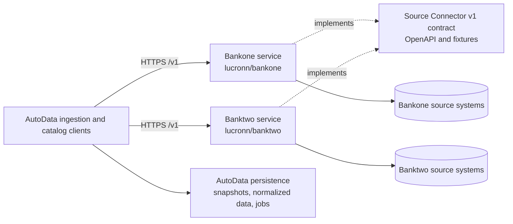

# Independent Bankone and Banktwo connectors

AutoData is the application and system of record. It calls Bankone and Banktwo
independently over the provider-neutral Source Connector v1 HTTP contract.
Each bank owns its upstream access, source-specific parsing and search, private
credentials, retries, caching, and source API. A bank does not call the other
bank, import AutoData code, or access AutoData persistence.

There is no Bankone-to-Banktwo or Banktwo-to-Bankone edge. The dashed contract
edges indicate that both independent services implement the same specification;
the contract is not a runtime service.

## Component locations

| Responsibility | Current location |
| --- | --- |
| Canonical wire contract and fixtures | [`packages/contracts/source-connector/v1/openapi.yaml`](../../packages/contracts/source-connector/v1/openapi.yaml), `packages/contracts/source-connector/v1/fixtures/` |
| Contract inventory and persisted provider mapping | [`packages/contracts/contract.json`](../../packages/contracts/contract.json) |
| AutoData HTTP client, validation, and provider registry | `workers/ingestion-python/src/autodata_ingestion/source_connector_client.py` |
| AutoData catalog callers | `workers/ingestion-python/src/autodata_ingestion/catalog_service.py`, `catalog_sync.py`, `catalog_years.py` |
| AutoData bank batch execution and tooling | `workers/ingestion-python/src/autodata_ingestion/bankone_batch.py` (canonical aliases `BankBatch`, `execute_bank_batch`, `build_bank_batch_plan`), `scripts/dev/ingest_bankone_service.py`, `scripts/dev/ingest_bankone_batch.py`, `scripts/dev/ingest_banktwo_service.py` |
| AutoData generic fetch-job store and additive import | `workers/ingestion-python/src/autodata_ingestion/source_job_persistence.py`, `db/migrations/036_source_fetch_jobs.sql` |
| AutoData runtime origin defaults | `.env.example`, `infra/compose/compose.yaml`, `infra/k8s/base.yaml` |
| Bankone source API and deployment | Independent repository [`lucronn/bankone`](https://github.com/lucronn/bankone); its checkout is not part of this AutoData tree |
| Banktwo source API and deployment | Independent repository [`lucronn/banktwo`](https://github.com/lucronn/banktwo); its checkout is not part of this AutoData tree |

The contract defines `GET /v1/capabilities`, `GET /v1/catalog/{scope}`,
`POST /v1/vehicle-resolutions`, vehicle-scoped article list/search, and
`GET /v1/resources/{opaqueRef}`. Its probes are `/healthz` and `/readyz`.
The OpenAPI document defines these paths; their live availability has not been
verified in this worktree.

## AutoData repository boundary

AutoData no longer vendors Bankone or Banktwo as Git submodules or build
contexts. The historical `services/autodbtwo` submodule path is removed. Local
clones of [`lucronn/bankone`](https://github.com/lucronn/bankone) or
[`lucronn/banktwo`](https://github.com/lucronn/banktwo) may exist beside this
repository for operator convenience, but they are not required to build, test,
or run AutoData. AutoData reaches each bank only through configured
`BANKONE_BASE_URL` / `BANKTWO_BASE_URL` HTTPS origins.

Tracked in [Issue #132](https://github.com/lucronn/autodata/issues/132) and
[Project #8](https://github.com/users/lucronn/projects/8).

## Names and persistence

Wire provider slugs are `bankone` and `banktwo`. AutoData maps them to the
historical persisted lineage values `autoapi` and `autoapitwo`, respectively.
These stored identifiers, article and snapshot identities, source versions,
locators, and historical migrations remain compatibility data. Their continued
presence does not mean AutoDBone or AutoDBtwo are current service names.

The contract carries opaque source references, source revision, fetched time,
request ID, and source locator. AutoData passes opaque references back to the
same bank; it does not interpret them as upstream URLs or identifiers. Resource
responses include original content or bytes, media type, and SHA-256. The
AutoData client validates the envelope and hash, then the ingestion pipeline
owns source snapshots, normalization, provenance, review, and object storage.
Provider asset references are fetched through that bank's resource endpoint;
they are not forwarded to the other bank.

AutoData uses the provider-neutral `source_fetch_jobs` table. Migration
`036_source_fetch_jobs.sql` imports historical Bankone rows while preserving
their UUIDs, idempotency keys, retry state, and snapshot links. The legacy
`autoapi_article_fetch_jobs` table is retained for compatibility and rollback;
it is not a bank-owned database or a reason for either bank to receive database
credentials.

## Local configuration and live status

The AutoData defaults are `https://bankone.cars.tk` and
`https://banktwo.cars.tk`, configured independently with `BANKONE_BASE_URL` and
`BANKTWO_BASE_URL`. Compose passes both values to ingestion services, Kubernetes
sets both values in its ConfigMap, and `.env.example` documents the defaults.
The client can also read `BANKONE_API_TOKEN` and `BANKTWO_API_TOKEN` from its
environment when an origin requires bearer authentication; no token values are
committed in the example configuration.

These are configured origins, not proof of live domains. As of this document's
local repository inspection, production DNS ownership, Vercel domain
attachments, TLS, deployed health/readiness, connector authentication, release,
and independent Bankone/Banktwo canaries remain **pending**. No production
deployment or live canary is claimed here. The old `cars.tk/bankone` and
`cars.tk/banktwo` shared-path arrangement and Banktwo-owned Bankone rewrite are
not the current target topology; do not infer that the apex or either subdomain
is attached to a particular project.

See the [design spec](../superpowers/specs/2026-10-08-independent-bank-connectors-design.md),
[implementation plan](../superpowers/plans/2026-10-08-independent-bank-connectors.md),
[API compatibility details](source-connector-api-compatibility.md), and
[domain status](bankone-banktwo-domain-routing.md).

## Durable article execution (November 2026)

Article discovery and content capture use separate durable jobs for each bank.
The canonical key includes provider, vehicle, optional configuration and both
opaque source references. A descriptor, resolution snapshot, resource or model
result from one key cannot satisfy another. A content-addressed S3 object can
share bytes while its persisted snapshot and observation retain their actual
provider/context ownership.

The dedicated entry point is `python scripts/dev/article_worker.py` (`--once`
for one claim, otherwise `--poll-seconds`, default 1). It uses existing
`AUTODATA_DB_ADDRESS`, `AUTODATA_POSTGRES_DB`, `AUTODATA_POSTGRES_USER` and
`AUTODATA_POSTGRES_PASSWORD`; S3 requires `AUTODATA_S3_ENDPOINT`,
`AUTODATA_S3_ACCESS_KEY`, `AUTODATA_S3_SECRET_KEY`, `AUTODATA_SOURCE_BUCKET`.
The bucket must already exist. Bank connector URLs/tokens and Mercury
`INCEPTION_*` configuration use the existing clients. Unconfigured model work
retains source content with explicit review state. Do not mount production
credentials into fixture containers.

`ArticleObjectStore` uses the real MinIO SDK with connect timeout 2 seconds,
read timeout 5 seconds and zero automatic SDK retries. Uploads accept only
content-addressed keys. Source IO runs outside transactions; a late upload may
leave an unreferenced object, but cannot write database references after losing
the lease. Heartbeats run every 10 seconds against a 90-second database lease.
The database, rather than a process cache, owns retry budget and current phase.

Publication creates a `catalog.article.published` outbox event in the same
transaction as the canonical pointer and completed job. Deploy the enrichment
outbox relay separately; NATS `Nats-Msg-Id` and envelope `idempotency_key` retain
the transformation key across replay. Consumers must deduplicate independently.
A broker outage leaves canonical content readable and the event pending.
An expired dispatched model request without a persisted response becomes
`ambiguous` in the actual reclaim/dead-letter transaction. Retrying may deliver
the external model request again; external delivery is not exactly once.

R6 must deploy both worker and relay and validate authenticated real-bank and
Mercury behavior. The isolated PostgreSQL/S3/NATS fixture evidence certifies
runtime boundaries and recovery, not production configuration or rollout.

Selected-article capture normalizes both explicit `year` and `model_year`
against the canonical year. Configuration-scoped capture loads the actual trim,
engine displacement, body style and drivetrain from the owning configuration
and identity base, retains their snapshot/evidence references, and compares
explicit source applicability before storing content or invoking Mercury. That
captured context remains immutable when configuration records later change.

## Production host relay wiring follow-up (2026-11-05)

At source baseline `c0be267fe31dc578bec0b8528679b6fd6671ed12`, development
Compose includes the publication relay, but the GCE production template and
normal-service runtime graph omit it. The host ingestion image also lacks the
enrichment relay package/script, and its NATS configuration permits only the
metrics identity. These repository omissions prevent the required publication
event path; this statement is not a live-host inspection.

The bounded plan is `docs/superpowers/plans/2026-11-05-production-outbox-relay.md`,
tracked in [child Issue #303](https://github.com/lucronn/autodata/issues/303) of
#186 and [Project #8](https://github.com/users/lucronn/projects/8). The synchronized
record is `docs/agents/records/2026-11-05-production-outbox-relay.json`.
Goal: Wire the existing publication outbox relay into the production GCE host graph with packaged code, dedicated PostgreSQL/NATS credentials, restricted broker permissions and fail-closed runtime verification.

Concrete todo:

- [x] Add failing relay packaging, render/topology, secret-contract, NATS authentication/ACL and runtime graph/readiness regressions.
- [x] Package the existing relay in the ingestion image and wire its dedicated backend-only service, credentials, manifest/private-material contract and narrowly scoped database/broker privileges.
- [x] Run focused and complete host regressions plus an isolated real PostgreSQL/NATS relay smoke proving canonical event delivery, replay identity and denied unrelated permissions; retain exact candidate evidence.
- [ ] Commit and push validated milestones, independently review the exact candidate, and synchronize Issue/Project/canonical documentation with verification evidence; deployment remains a separate decision.

The implemented relay contract uses the existing ingestion image, backend-only relay
address `172.30.20.14`, dedicated `autodata_outbox` database identity and a
separate NATS publisher with exact publication/stream-create/info permissions.
The plan defines the authoritative file allowlist and secret/ACL details.
Existing delivery leases, stable Nats-Msg-Id/idempotency_key and consumer
deduplication remain required. Actual credential/role provisioning, private
broker-config delivery and live service activation require separate deployment
authorization. Candidate `8f3735820670a027e2237c62bf2b85dcb94f0cd3` has passed
local real-service delivery/replay/ACL/outage verification; see
`docs/verification/2026-11-05-production-outbox-relay.md`. The separately gated
host activation fix includes relay startup, stop, recovery and a bounded exact
nine-service inventory. Local verification passes (433 host tests, 104 focused
activation tests and the real-service smoke); final independent review remains
pending. No deployment has occurred.

### Production relay activation scope amendment

Original gate `a13cf0879d3551eec23c119829c7993b6b5bd6de` remains preserved.
Review at candidate `e8473a792e86d7b19f7b2de2e22bc35b3c1cf5b3` found that
`host_activation.py` APPS/start/stop/recovery/inventory and its eight-service cap
would omit or reject the relay. The synchronized Issue #303/Project #8 plan now
adds exactly `infra/deploy/gce/host_activation.py` and
`infra/deploy/gce/test_host_activation.py`, for15 intended implementation paths.
Task index: `docs/agents/tasks/2026-11-03-production-release/production-outbox-relay.json`.

Additional concrete todo:

- [x] Include outbox-relay in host activation startup, stop, recovery and inventory, replace the eight-service inventory cap with the exact nine-service graph, and prove missing, stopped, duplicate, foreign or tenth-container rejection in activation regressions.

The exact normal-service graph is nine services: caddy, api, ingestion-http,
article-worker, payment-reconciler, outbox-relay, postgres, nats and minio.
Preserve maintenance-first startup, orderly stop/recovery, exact inventory
identity/security checks, duplicate rejection and foreign/tenth-container denial.
This amendment authorizes no live host or service operation.
